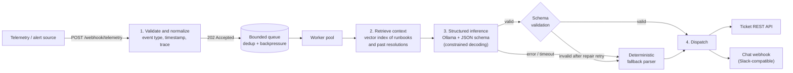

# AI Incident Triage Webhook

A webhook-triggered AI workflow that turns raw operational logs and incident alerts into **structured triage decisions**, using RAG over runbooks and a **local Ollama LLM** (Mistral / Llama). Results are dispatched as chat alerts and tracked tickets.

> Portfolio write-up: *trigger -> what it does -> what I had to iterate on* (see [Walkthrough](#walkthrough)).

## Architecture



## Walkthrough

### Trigger
An HTTP webhook, `POST /webhook/telemetry`, receives unstructured logs or alerts: JSON with arbitrary field names (`msg`/`message`, `ts`/`timestamp`, `error`/`stack_trace`, ...) or plain-text log lines. The handler only validates and enqueues, then returns `202` straight away, so the sender is never blocked on LLM latency.

### What it does
| Stage | Module | Behaviour |
|---|---|---|
| 1. Validation & extraction | [`normalize.py`](triage/normalize.py) | Size limit, optional HMAC signature, alias mapping, timestamp parsing (ISO / epoch / in-text), level mapping, event-type inference (explicit type, exception class, or known patterns). Invalid payloads get `422`. |
| 2. Context retrieval | [`knowledge.py`](triage/knowledge.py) | Runbooks are chunked per section and embedded with the past resolutions into a local vector index. Cosine top-k retrieval. Embeddings come from Ollama (`nomic-embed-text`) or an offline hashing embedder. |
| 3. Structured inference | [`llm.py`](triage/llm.py), [`prompt.py`](triage/prompt.py) | A strictly typed system prompt plus the `Triage` JSON schema, sent to Ollama's `format` parameter, with `temperature=0`. Output: `severity`, `failure_mode`, `root_cause_probability`, `summary`, `remediation_steps`. |
| 4. Dispatch | [`dispatch.py`](triage/dispatch.py) | Creates a ticket via REST, then posts a chat alert that references the ticket. Retries with backoff. Falls back to a local JSONL outbox when no endpoints are configured. |

### What I had to iterate on

**Schema reliability.** Raw text output had hallucinated keys and intermittent markdown fences. What fixed it:
1. Constrained decoding: the pydantic schema (`extra="forbid"`) is passed to Ollama as `format`.
2. A defensive extractor that strips fences and surrounding prose.
3. Strict validation, which rejects unknown keys, bad enums and out-of-range probabilities.
4. One repair retry that feeds the validation error back to the model.
5. A [deterministic fallback](triage/fallback.py) (rule-based severity plus the matched runbook's remediation) so every event still yields valid JSON. Each result records `source: "llm" | "fallback"`.

**Latency under load.** High-concurrency bursts choked inference. What changed:
- A bounded queue with a fixed worker pool sized to Ollama's parallelism, `429 + Retry-After` when full, and fingerprint dedup so alert storms collapse into one job ([`queueing.py`](triage/queueing.py)).
- A smaller prompt: targeted section-level chunks, a hard character budget on retrieved context, and head+tail trace trimming ([`prompt.py`](triage/prompt.py)).
- Per-stage timings (`queue_wait`, `retrieval`, `inference`, `dispatch`) on every result, plus `/metrics` p50/p95, so the effect is measurable.

[`scripts/benchmark.py`](scripts/benchmark.py) reproduces the comparison: run it against a "naive" configuration (large context, no trimming) and the default one. Results depend on hardware and model, so treat your own numbers as the source of truth.

## Quick start

```bash
python -m venv .venv && source .venv/bin/activate     # Windows: .venv\Scripts\activate
pip install -r requirements.txt
pytest                                                # 19 hermetic tests, no Ollama needed

# optional: real LLM
ollama pull mistral && ollama pull nomic-embed-text   # set EMBEDDING_BACKEND=ollama to use the latter

uvicorn triage.main:app --port 8000
python scripts/send_sample.py                         # posts samples/events.json, prints results
```

Without Ollama running, every event takes the deterministic fallback path, so the service still works end to end. Dispatched tickets and alerts land in `outbox/dispatch.jsonl`.

```bash
curl -X POST localhost:8000/webhook/telemetry -H 'content-type: application/json' \
  -d '{"service":"orders-api","level":"ERROR","message":"too many connections","stack_trace":"psycopg2.OperationalError: too many connections"}'
curl localhost:8000/events/<event_id>
curl localhost:8000/metrics
```

## Configuration (environment variables)

| Variable | Default | Purpose |
|---|---|---|
| `OLLAMA_URL` / `LLM_MODEL` | `http://localhost:11434` / `mistral` | Inference backend (`llama3.1` etc. also work) |
| `EMBEDDING_BACKEND` / `EMBED_MODEL` | `hashing` / `nomic-embed-text` | `hashing` = offline, `ollama` = semantic embeddings |
| `TOP_K`, `MAX_CONTEXT_CHARS`, `MAX_TRACE_LINES` | `3`, `3000`, `30` | Prompt budget |
| `WORKERS`, `QUEUE_SIZE`, `DEDUP_TTL_S` | `2`, `256`, `60` | Concurrency and buffering |
| `WEBHOOK_SECRET` | unset | Require `X-Signature-256: sha256=<hmac>` |
| `CHAT_WEBHOOK_URL`, `TICKET_API_URL`, `TICKET_API_TOKEN` | unset | Real dispatch targets (otherwise the outbox is used) |
| `NOTIFY_MIN_SEVERITY`, `TICKET_MIN_SEVERITY` | `medium` | Severity gates |

## Project layout
```
triage/        normalize, knowledge, prompt, llm, fallback, dispatch, pipeline, queueing, main
knowledge/     runbooks/*.md and past_resolutions.jsonl (the vector-index corpus)
samples/       example telemetry payloads
scripts/       send_sample.py, benchmark.py
tests/         pytest suite (mocked Ollama via httpx.MockTransport)
```

## Limitations
- The vector index is in-memory and rebuilt at startup; fine for hundreds of chunks, not millions (swap in FAISS / pgvector).
- Job state and dedup live in process memory; a production version would use Redis or a durable queue.
- The hashing embedder is lexical, not semantic; use `EMBEDDING_BACKEND=ollama` for real embeddings.

## License
MIT
